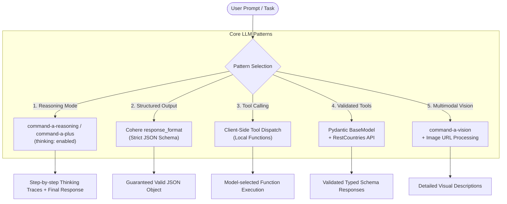

# Cohere Core LLM Patterns

[](https://www.python.org/downloads/)
[](https://cohere.com/)
[](https://docs.pydantic.dev/)
[](https://opensource.org/licenses/MIT)

A curated, practical laboratory exploring foundational Generative AI patterns using **Cohere's ClientV2 API** alongside **Pydantic** and external REST services.

This repository demonstrates how to build reliable, structured, and multimodal AI workflows beyond simple text prompts—focusing on deterministic schema outputs, external tool calling, step-by-step thinking traces, and visual reasoning.

---

## Architecture & Capabilities



---

## Pattern Matrix

| Script | Pattern | Model Used | Key Concept |
|---|---|---|---|
| [`01_cohere_reasoning.py`](examples/01_cohere_reasoning.py) | **Chain-of-Thought & Reasoning** | `command-a-plus-05-2026`<br>`command-a-reasoning-08-2025` | Inspecting internal thinking blocks vs direct responses using `thinking={"type": "enabled"}`. |
| [`02_cohere_structured_json.py`](examples/02_cohere_structured_json.py) | **Guaranteed JSON Schema** | `command-a-plus-05-2026` | Enforcing strict JSON object shapes, types, arrays, and required keys via `response_format`. |
| [`03_cohere_tool_calling.py`](examples/03_cohere_tool_calling.py) | **Basic Function/Tool Calling** | `command-a-plus-05-2026` | Tool definition schema, detecting model tool calls, local execution, and feeding results back. |
| [`04_cohere_tools_pydantic_api.py`](examples/04_cohere_tools_pydantic_api.py) | **Advanced Tools + Pydantic** | `command-a-03-2025` | Integrating live REST API lookups (`restcountries.com`) validated and serialized through Pydantic models. |
| [`05_cohere_multimodal_vision.py`](examples/05_cohere_multimodal_vision.py) | **Multimodal Vision** | `command-a-vision-07-2025` | Fetching external image streams (The Cat API) and performing deep semantic visual reasoning. |
| [`06_openai_chat_baseline.py`](examples/06_openai_chat_baseline.py) | **OpenAI SDK Baseline** | `gpt-4o-mini` | Comparative reference implementation using standard OpenAI chat completions. |

---

## Project Structure

```text
LLM-cohere-core-llm-patterns/
├── .env.example                               # Environment template
├── .gitignore                                 # Git ignore patterns
├── README.md                                  # Repository documentation
├── requirements.txt                           # Production dependencies
└── examples/
    ├── 01_cohere_reasoning.py                 # Chain-of-thought & thinking traces
    ├── 02_cohere_structured_json.py           # Strict JSON Schema formatting
    ├── 03_cohere_tool_calling.py              # Native tool and function calling
    ├── 04_cohere_tools_pydantic_api.py        # Pydantic validation + REST API fallback
    ├── 05_cohere_multimodal_vision.py         # Image understanding & multimodal analysis
    └── 06_openai_chat_baseline.py             # Reference comparison with OpenAI API
```

---

## Getting Started

### 1. Prerequisites
- Python 3.10 or higher
- A Cohere API key ([Cohere Dashboard](https://dashboard.cohere.com/api-keys))
- (Optional) OpenAI API Key & Cat API Key

### 2. Installation

```bash
# Clone the repository
git clone https://github.com/<your-username>/LLM-cohere-core-llm-patterns.git
cd LLM-cohere-core-llm-patterns

# Create and activate a virtual environment
python -m venv .venv

# Windows:
.venv\Scripts\activate
# Linux/macOS:
source .venv/bin/activate

# Install required dependencies
pip install -r requirements.txt
```

### 3. Configure Environment Variables

Copy `.env.example` to `.env` and fill in your keys:

```bash
cp .env.example .env
```

Edit `.env`:
```env
COHERE_API_KEY=your_actual_cohere_api_key_here
CAT_API_KEY=optional_key_here
OPENAI_API_KEY=optional_openai_key_here
```

---

## Running the Examples

### 1. Reasoning & Thinking Mode
```bash
python examples/01_cohere_reasoning.py
```
> **Sample Output:**
> ```text
> [Thinking Process]:
> The user is asking to estimate the time taken by a Marlin to cross the Nile river.
> First, retrieve swimming speed of a marlin (up to ~68 mph / 110 km/h).
> Nile width varies (average ~2.8 km, widest point ~7.5 km)...
>
> [Answer]:
> At full speed (~68 mph), a marlin would take approximately 1.5 to 2.5 minutes to cross the river.
> ```

### 2. Guaranteed JSON Schema
```bash
python examples/02_cohere_structured_json.py
```
> **Sample Output:**
> ```json
> {
>   "writer": "Rabindranath Tagore",
>   "prize": true,
>   "year": 1913,
>   "best_selling_books": [
>     "Gitanjali",
>     "The Home and the World",
>     "Gora",
>     "Kabuliwala"
>   ]
> }
> ```

### 3. Tool / Function Calling
```bash
python examples/03_cohere_tool_calling.py
```
> **Execution Steps:**
> 1. Cohere determines tool execution is needed and produces a tool call for `get_the_Language` with argument `{"location": "Maharashtra"}`.
> 2. Local Python dispatcher runs function and returns `{"location": "Maharashtra", "language": "Marathi"}`.
> 3. Cohere integrates tool output and replies: *"The primary official language spoken in Maharashtra, India is Marathi."*

### 4. Advanced Tool Calling with Pydantic & REST API
```bash
python examples/04_cohere_tools_pydantic_api.py
```
> Validates complex nested objects (languages, traditional cuisine, attire) through Pydantic's `BaseModel` before returning responses to the caller.

### 5. Multimodal Vision
```bash
python examples/05_cohere_multimodal_vision.py
```
> Submits a live image URL to `command-a-vision-07-2025` and produces detailed visual observations.

---

## Key Technologies
- **[Cohere SDK v2](https://github.com/cohere-ai/cohere-python)**: Modern unified client interface (`ClientV2`).
- **[Pydantic v2](https://docs.pydantic.dev/)**: Data validation, schema generation, and serialization.
- **[Requests](https://requests.readthedocs.io/)**: HTTP client for external API tools.
- **[Python Dotenv](https://github.com/theskumar/python-dotenv)**: Secure environment configuration management.

---

## License
Distributed under the [MIT License](LICENSE).
